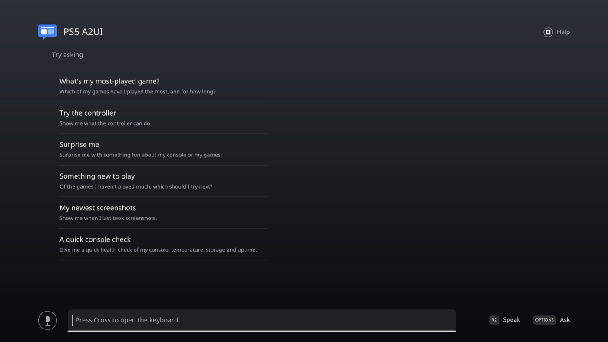

# ps5-agentic-ui

[](https://github.com/Laptopmini/ps5-agentic-ui/actions/workflows/ci.yml)
[](LICENSE)

Open-source tooling for **agentic UI on a PlayStation 5**, built on [AG-UI](https://docs.ag-ui.com), [A2UI 1.0](https://a2ui.org) and [CopilotKit](https://docs.copilotkit.ai). An agent answers with native, controller-driven screens instead of text: menus, shelves of tiles, dashboards, the system keyboard, system dialogs, haptics.



You don't need a PS5 to try it. The renderer and the agent run on a Mac or Linux desktop, and the same code runs on the console.

## What's in here

| | What it is | Where | Get it |
|---|---|---|---|
| **A2UI renderer** (C++20) | Draws A2UI 1.0 surfaces from the PS5 catalog as console screens and turns controller input into A2UI actions. Platform-independent: you supply a `Canvas`. | [`renderer/`](renderer/README.md) | CMake: `a2ui::a2ui` |
| **Agent runtime** (TypeScript) | An AG-UI agent that answers with those screens. Brings the intent tools, an approval gate, secret handles and an HTTP server; you bring a model and your own tools. Runs in Node, or in QuickJS on the console. | [`runtime/`](runtime/README.md) | npm: `ps5-a2ui-agent` |
| **CopilotKit Channels adapter** (TypeScript) | Makes the PS5 a channel, like Slack or Discord: an agent elsewhere reaches the player on the console. | [`channel/`](channel/README.md) | npm: `copilotkit-channels-ps5` |
| **PS5 catalog** | The A2UI 1.0 catalog of native PS5 components and controller functions: the contract between the three above. Frozen for 1.0. | [`catalog/ps5.catalog.json`](catalog/ps5.catalog.json) | by URL (its `catalogId`) |
| **PS5 A2UI** (demo app) | A homebrew app built only from the pieces above: its own on-console agent, voice input through the DualSense mic, a home-screen tile, notifications while you play. Also the reference for the console bindings (DualSense, system keyboard, dialogs). | [`payload/console/`](payload/console/) | build it, below |

## Try it

### 1. See the renderer (no PS5, no model key)

Needs CMake 3.24+, a C++20 compiler and SDL2 (`brew install cmake sdl2`, or `apt install cmake g++ libsdl2-dev libcurl4-openssl-dev libsqlite3-dev`).

```sh
git clone https://github.com/Laptopmini/ps5-agentic-ui.git && cd ps5-agentic-ui
cmake -S renderer -B renderer/build && cmake --build renderer/build -j 8
renderer/build/a2ui-host renderer/fixtures/home-shelves.jsonl
```

A window opens with a screen an agent produced, recorded as a file. Arrow keys are the D-pad, Enter is Cross, Esc is Circle; a DualSense paired with the computer works too. The other files in [`renderer/fixtures/`](renderer/fixtures/) are more screens.

### 2. Talk to the agent (no PS5)

Also needs Node 24+ and pnpm, and a key for any OpenAI-compatible endpoint with a model that supports tool calls.

```sh
pnpm install

# OpenRouter is the default endpoint:
LLM_API_KEY=...  LLM_MODEL=<model id>  scripts/play.sh

# Any other OpenAI-compatible endpoint (OpenAI, LM Studio or Ollama on your network, …):
LLM_BASE_URL=http://localhost:1234/v1  LLM_API_KEY=...  LLM_MODEL=<model id>  scripts/play.sh
```

This starts the demo agent and the same window. Press O (Options) to type a request, such as "show me my games" or "connect to Wi-Fi". Off the console, the agent's tools act on a simulated console.

### 3. On a PS5

Needs a console that runs homebrew (tested on firmware 12.70) with `ftpsrv` and `websrv` running, and Docker on your computer for the build.

```sh
PS5_HOST=<console ip> scripts/ps5-install.sh console      # build and install; start it from the Homebrew Launcher
```

To install without building, download `PS5AgenticUI-1.0.0.zip` from the [1.0.0 release](https://github.com/Laptopmini/ps5-agentic-ui/releases/tag/v1.0.0), copy the `PS5AgenticUI` folder inside it to `/data/homebrew/PS5AgenticUI` over FTP, and start "PS5 A2UI" from the Homebrew Launcher.

The app opens on a setup screen. From there:

- **Square** starts the offline demo: sample screens and a canned conversation, no key needed.
- **Scan the QR code** with a phone to give the console a model key (encrypted for the console before it leaves the page). The agent then runs on the console itself.
- Or run the agent on your computer and point the console at it: `PS5_HOST=<console ip> LLM_API_KEY=... LLM_MODEL=... scripts/ps5-play.sh`. The key stays on the computer. An agent on your computer works on a simulated console (made-up games and saves); to read the real one, run the agent on the console or use a channel.
- Or make the console a CopilotKit channel: `scripts/ps5-channel.sh`, see [`docs/channel.md`](docs/channel.md).

Voice input (hold R2 and speak) needs a speech model next to the app; see [`docs/voice.md`](docs/voice.md). [`docs/packaging.md`](docs/packaging.md) explains the toolchain and what gets installed.

## Use the libraries

**Render A2UI in your own C++ app.** [`renderer/examples/hello`](renderer/examples/hello/) is a complete consumer in 70 lines.

```cmake
include(FetchContent)
FetchContent_Declare(a2ui
  GIT_REPOSITORY https://github.com/Laptopmini/ps5-agentic-ui.git
  GIT_TAG        v1.0.0
  SOURCE_SUBDIR  renderer)
FetchContent_MakeAvailable(a2ui)
target_link_libraries(your_app PRIVATE a2ui::a2ui)
```

**Build your own agent for the console.**

```ts
import { AgentThread, modelFromEnv, serveAgent } from "ps5-a2ui-agent";

const tools = [{
  name: "list_lobbies",
  description: "List the multiplayer lobbies that are open right now.",
  run: async () => ({ lobbies: await fetchLobbies() }),
}];

await serveAgent({ thread: (id) => new AgentThread(id, { model: modelFromEnv(), tools }) });
```

**Reach the console from an agent you already have**, through CopilotKit Channels:

```ts
import { ps5 } from "copilotkit-channels-ps5";

const channel = createChannel({ name: "my-agent", adapters: [ps5()], agent });
```

## How it fits together

```
 model (any OpenAI-compatible endpoint)
   │  tool calls: show_menu, show_shelf, ask_text, confirm, controller_feedback, your tools…
 agent runtime ──────── turns intent tools into A2UI 1.0 surfaces on the PS5 catalog
   │  AG-UI events (SSE, or in-process on the console)          ▲
   │                                                            │ or: any agent, through
 renderer ───────────── draws surfaces, moves focus,            │ the CopilotKit Channels
   │                    sends presses back as A2UI actions      │ adapter
 Canvas + device layer ─ SDL2/GLES, DualSense, system keyboard and dialogs
```

The model never writes UI trees. It calls small, flat **intent tools**, and the runtime translates each call into a valid A2UI surface. On the catalog eval the same model produced a correct screen in 15 of 16 scenarios with intent tools, and in 1 of 16 when asked to write A2UI itself ([`docs/agent.md`](docs/agent.md)).

## Docs

- [`docs/PLAN.md`](docs/PLAN.md): the goal, the architecture and the key decisions.
- [`docs/agent.md`](docs/agent.md): A2UI over AG-UI, the catalog, intent tools, what a model can drive.
- [`docs/channel.md`](docs/channel.md): the PS5 as a CopilotKit channel, and reaching the player during a game.
- For PS5 homebrew developers, reusable on their own:
  - [`docs/packaging.md`](docs/packaging.md): getting a C++ app with a window, networking and the GPU onto a console.
  - [`docs/rendering.md`](docs/rendering.md): software and GPU drawing, RADV Vulkan and GPU compute from a payload.
  - [`docs/voice.md`](docs/voice.md): capturing the DualSense mic, and speech-to-text on the console's GPU.
- [`BACKLOG.md`](BACKLOG.md): what's open. [`CHANGELOG.md`](CHANGELOG.md): what's released.

`eval/` holds the harnesses behind the findings (can a model drive the catalog, multi-turn flows, the approval gate). They aren't needed to use the libraries.

## Status

1.0. The catalog is frozen at the [`catalog-v1`](https://github.com/Laptopmini/ps5-agentic-ui/tree/catalog-v1) tag; the libraries follow semantic versioning from here. Verified on a PS5 on firmware 12.70, on macOS and on Linux.

This is an independent project. It is not affiliated with or endorsed by Sony Interactive Entertainment, CopilotKit or Google. "PlayStation", "PS5" and "DualSense" are trademarks of Sony Interactive Entertainment Inc.

## Contributing and security

See [`CONTRIBUTING.md`](CONTRIBUTING.md). To report a vulnerability, see [`SECURITY.md`](SECURITY.md).

## License

MIT ([`LICENSE`](LICENSE)). One exception: the home-screen tile (`payload/tile`) is GPL-3.0-or-later because it links drakmor's boilerplate; it's a separate program that only asks websrv to start the app. Vendored and linked third-party code keeps its own license: see [`THIRD-PARTY-NOTICES.md`](THIRD-PARTY-NOTICES.md).
